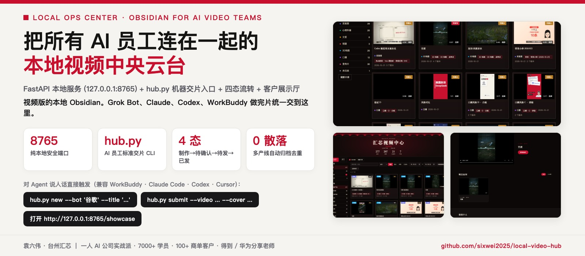
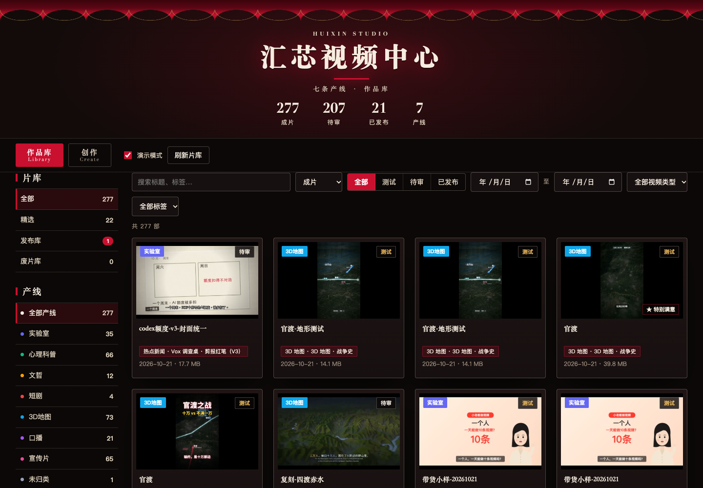
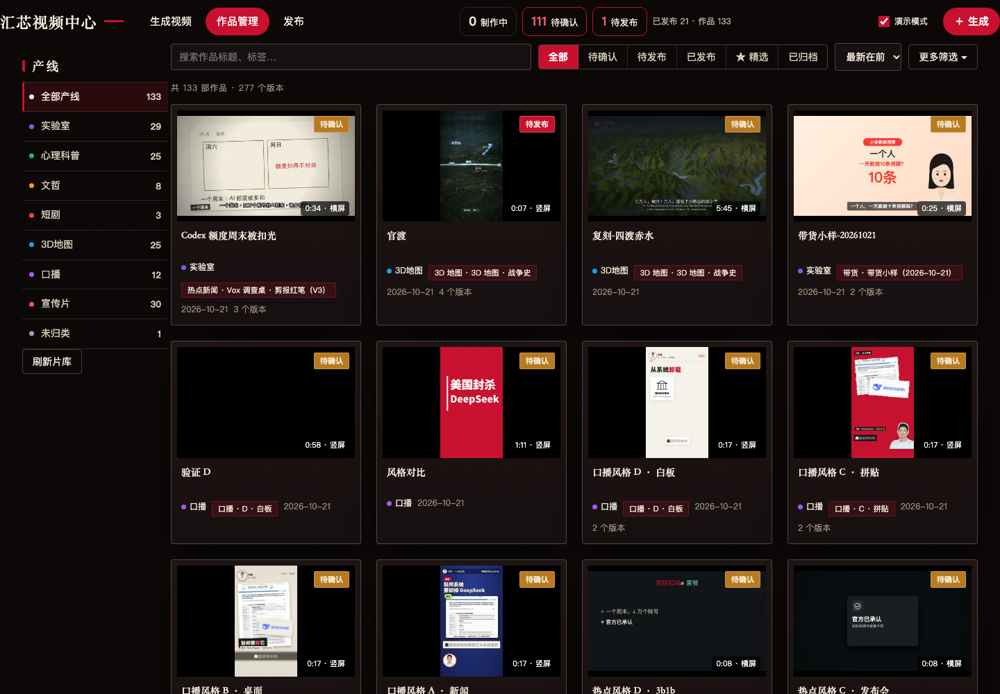
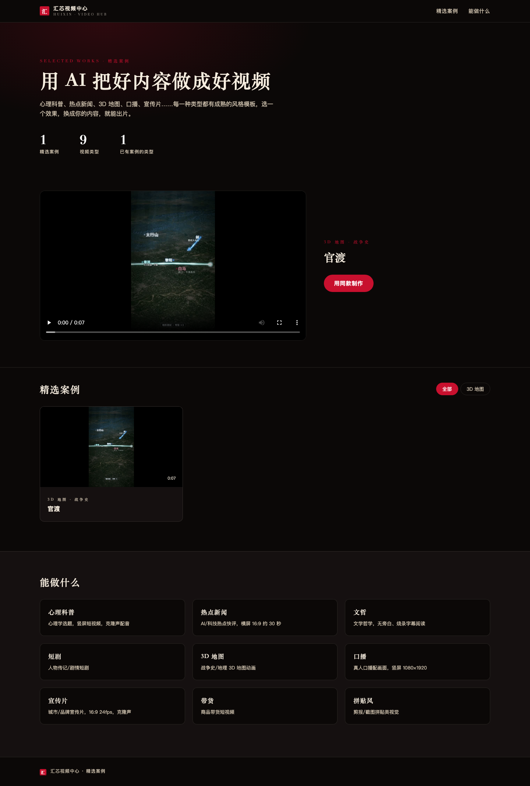
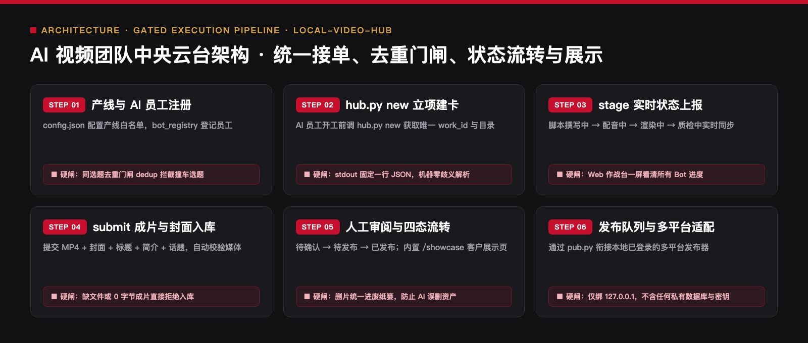

<div align="center">



# 本地视频中心（Local Video Hub）
### `local-video-hub` · 视频版的本地 Obsidian · 多 AI 员工统一交片与排产中央云台

[](#三系统架构与六步交片流转)
[](#四ai-员工标准交片协议-hubpy)
[](#七安全边界与隐私保护)
[](LICENSE)

> 🔴 **作者：袁六伟 · 台州汇芯**｜一人 AI 公司创业者，学员 7000+，客户 100+，得到 / 华为分享老师  
> 📮 更多 AI 视频与自动化实战，关注 **公众号 / 视频号：袁六伟**

**它不只是一个视频文件夹浏览器——它是把你手底下所有 AI 员工连成一支正规军的中央作战台。**  
Grok Bot、Claude Code、Codex、WorkBuddy……每个 AI 员工做完短视频后，不再把成片乱扔在桌面各个角落，而是通过统一的 `hub.py` 命令行把**成片、封面、标题、风格、状态**交回同一个本地中央云台（`127.0.0.1:8765`）。

```bash
git clone https://github.com/sixwei2025/local-video-hub.git
cd local-video-hub && cp config.example.json config.json
./start.sh   # 浏览器打开 http://127.0.0.1:8765
```

[它解决什么痛点](#一为什么多-ai-员工团队必须有一个本地视频中心) · [三端界面实拍](#二三大核心工作台实拍) · [六步交片架构](#三系统架构与六步交片流转) · [`hub.py` 机器交片协议](#四ai-员工标准交片协议-hubpy) · [快速启动与产线配置](#五3-分钟启动与自定义产线)

</div>

---

## 一、为什么多 AI 员工团队必须有一个「本地视频中心」？

当你只有一个 AI 助手时，视频放桌面还能找得到；当你同时跑着「心理科普 Bot」「3D 地图 Bot」「口播切片 Bot」「暗黑数据 Bot」四五条产线时，灾难就来了：

| 没有 `local-video-hub` 之前 | 接入 `local-video-hub` 之后 |
| :--- | :--- |
| 成片散落在桌面十几个工程文件夹，老板每天人肉翻找验收 | **统一作品卡视图**：产线、出品 Bot、封面、时长、版本一目了然 |
| 两个 AI 员工同时抓了同一个热点，重复烧算力做重题 | **内置同选题去重门闸（`dedup_*.py`）**，立项时自动拦截撞车选题 |
| AI 嘴上汇报「做完了」，点开一看文件不存在或音画没合成 | **`hub.py submit` 机械验真**：强制校验 MP4 与封面文件实体，stdout 吐单行 JSON |
| 客户来访想看案例，临时去翻杂乱的网盘和本地目录 | **内置 `/showcase` 电影幕布级客户展示厅**，一键切换对外演示模式 |

---

## 二、三大核心工作台实拍

<table>
  <tr>
    <td width="33%" align="center">
      
      <br /><sub><b>① 作品管理主控台</b>：按产线/状态（制作中→待确认→待发布→已发布）筛选与审片</sub>
    </td>
    <td width="33%" align="center">
      
      <br /><sub><b>② 视频知识库总览</b>：统计总作品数、今日新增、各 AI 员工产能与风格分布</sub>
    </td>
    <td width="33%" align="center">
      
      <br /><sub><b>③ 客户展示厅 (<code>/showcase</code>)</b>：深色电影幕布 + 品牌红点缀，专供商务洽谈演示</sub>
    </td>
  </tr>
</table>

---

## 三、系统架构与六步交片流转

<p align="center">
  
</p>

---

## 四、AI 员工标准交片协议（`hub.py`）

核心纪律：**所有 AI 员工出片只走固定 CLI 入口，不靠自然语言口头约定**。每条命令在 `stdout` 严格输出一行机器可读的 JSON（包含 `ok` 布尔值与 `work_id`），人类可读提示输出在 `stderr`：

```bash
cd ~/local-video-hub

# 1. 开工立项：注册出品 Bot 与产线，获取唯一 work_id 与标准输出目录
.venv/bin/python hub.py new --bot "短视频操盘手1·心理科普" --line psych --title "为什么越解释越没人信"

# 2. 过程上报：实时同步当前渲染阶段
.venv/bin/python hub.py stage <work_id> "渲染中"

# 3. 完工交片：提交成片、封面、发布标题、简介与话题标签（自动进入「待确认」队列）
.venv/bin/python hub.py submit <work_id>   --video ~/Desktop/产线A-心理科普/成片.mp4   --cover ~/Desktop/产线A-心理科普/封面.jpg   --title "越解释越没人信？心理学叫防御性失权"   --desc "30秒看懂人际博弈底层机制"   --topics "心理学,认知觉醒,人际关系"

# 4. 查询单卡详情或队列状态
.venv/bin/python hub.py show <work_id>
.venv/bin/python hub.py list --status "待确认"
```

完整接单与入库规范详见：[`docs/Grokbot提交规范.md`](docs/Grokbot提交规范.md)、[`docs/成片自动入库.md`](docs/成片自动入库.md) 与 [`docs/机器人接单/`](docs/机器人接单/)。

---

## 五、3 分钟启动与自定义产线

### 1. 环境要求与一键启动
- **依赖**：Python 3.11+、`ffmpeg`（含 `ffprobe`）
- **启动**：
```bash
git clone https://github.com/sixwei2025/local-video-hub.git
cd local-video-hub
cp config.example.json config.json
./start.sh
# 服务默认绑定 http://127.0.0.1:8765
# 停止服务：kill $(cat data/server.pid)
```

### 2. 改成你自己的团队产线（编辑 `config.json`）
- `scan_roots` / `output_dirs`：配置你本机桌面上的各条视频产线目录（自动排除 `.venv`、`node_modules` 等工程目录）。
- `bot_registry.json`：登记你团队里的 AI 员工名册与职责。
- `styles.json`：对齐你在用的短视频 Skill 风格库（如 WarFX 3D 地图、暗黑信息图、Remotion 心理科普等）。

---

## 六、仓库目录结构

```text
local-video-hub/
├── app.py                             # FastAPI 核心服务、作品扫描引擎与 REST API
├── hub.py / hub_lib.py                # ★ AI 员工标准交片 CLI 入口与状态机实现
├── queue_lib.py / cli.py              # 任务队列管理与命令行工具
├── dedup_*.py                         # 同选题相似度计算与立项去重门闸
├── publish_*.py / pub.py              # 多平台发布队列适配层（对接本机已登录发布器）
├── bot_registry.json                  # AI 员工编制登记表
├── styles.json                        # 短视频视觉风格注册表
├── config.example.json                # 产线与目录配置模板
├── static/                            # Web 作战台前端与 /showcase 客户展示厅
├── docs/                              # UI 设计规范、GrokBot 交片协议与机器人接单手册
├── tools/                             # 桌面存量成片补扫、封面提取等辅助脚本
└── tests/                             # 核心状态流转与去重门闸自动化测试
```

---

## 七、安全边界与隐私保护

- **纯本地环回绑定**：默认仅监听 `127.0.0.1:8765`，不向公网暴露任何端口。
- **防误删保护**：Web 端执行删除操作时统一移入本地废纸篓，防止人工或 AI 误删算力成品。
- **零敏感数据入库**：`data/meta.db`、`queue/*` 及日志均已加入 `.gitignore`，开源仓库不包含任何个人媒体资产或平台 Cookie。

---

## 关于作者与开源生态

**袁六伟 · 台州汇芯**：一人 AI 公司创业者，学员 7000+，服务商单客户 100+，覆盖近 20 个行业，得到 / 华为分享老师。AI 变现实战派，自己跑通才拿出来教。

- 公众号：**袁六伟**（微信搜一搜关注，看更多 AI 工具实测与一人公司实战）
- 视频号：**袁六伟**

这个项目免费开源。如果它帮你的产线省下了每天反复返工的时间，欢迎在右上角点个 ⭐ **Star**，也欢迎转发给身边做内容或一人公司的朋友。

### 同系列开源 Skill 矩阵（袁六伟 · 台州汇芯）

| 仓库 | 领域 | 核心能力 |
| :--- | :--- | :--- |
| [**workbuddy-wechat-autopilot**](https://github.com/sixwei2025/workbuddy-wechat-autopilot) | 公众号全链路 | 九步硬闸总控：选题→写稿→真实截图→6套封面→6套排版→三重校验→草稿箱 |
| [**wechat-cover-skill**](https://github.com/sixwei2025/wechat-cover-skill) | 公众号视觉 | 封面渲染引擎（6套高客单价杂志风 + 黑红金 v2b + DOM 几何硬闸） |
| [**gzh-million-layout-skill**](https://github.com/sixwei2025/gzh-million-layout-skill) | 公众号排版 | 汇芯红 `#C8102E` 六套 100% 内联 CSS 骨架 + 乱码硬闸 + 配图皮肤 |
| [**ai-tool-review-wechat-skill**](https://github.com/sixwei2025/ai-tool-review-wechat-skill) | 公众号评测 | AI 工具真跑评测工作流（5项一票否决 + 说人话硬闸 + 证据表） |
| [**hit-title-expert-skill**](https://github.com/sixwei2025/hit-title-expert-skill) | 爆款标题 | 一次直出 10 条 14–22 字高浓缩狠标题（5大公式 × 5类钩子词） |
| [**auto-tutorial-skill**](https://github.com/sixwei2025/auto-tutorial-skill) | 短视频工程 | 链接/网页/真机截图 → 3:4 封面 + 1.5x 配音 + 红框标注教程视频 |
| [**talking-head-video-skill**](https://github.com/sixwei2025/talking-head-video-skill) | 短视频工程 | 1080×1920 竖屏真人口播短视频（ASR 错字校对 + 逐字卡拉OK字幕 + 6项QC） |
| [**3d-map-video-skill**](https://github.com/sixwei2025/3d-map-video-skill) | 短视频工程 | MapLibre 3D 地形 + WarFX 战争特效（粒子行军/点阵兵力/震屏混音） |
| [**psych-kepu-video-skill**](https://github.com/sixwei2025/psych-kepu-video-skill) | 短视频工程 | Remotion + JSON 驱动的 15–30s 深色扁平动画心理科普短视频 |
| [**dark-infographic-video-skill**](https://github.com/sixwei2025/dark-infographic-video-skill) | 短视频工程 | 纯 Python + FFmpeg 暗黑流光数据可视化科普片（含 v2 手机外放配乐） |
| [**local-video-hub**](https://github.com/sixwei2025/local-video-hub) | AI 团队基建 | 视频版本地 Obsidian：多 AI 员工统一交片、去重门闸与四态流转云台 |
| [**yuanliuwei-ai-skills**](https://github.com/sixwei2025/yuanliuwei-ai-skills) | 一人公司方法 | PACT 72h 需求验证模型与一人 AI 公司 10 大业务决策模块 |
| [**book-skill**](https://github.com/sixwei2025/book-skill) | 知识工程 | 上传任意书籍 PDF → 自动提炼方法论生成 `.skill` + 公众号导流文案 |
| [**huangdi-skill**](https://github.com/sixwei2025/huangdi-skill) | 认知操作系统 | 中国历史八大皇帝（秦始皇/汉武帝/唐太宗等）一手史料认知框架蒸馏 |
| [**sunrise-tracker**](https://github.com/sixwei2025/sunrise-tracker) | 选题雷达 | 小红书 AI 赛道 10 倍异常流量「低粉爆文」每日早 7 点监测推送 |
